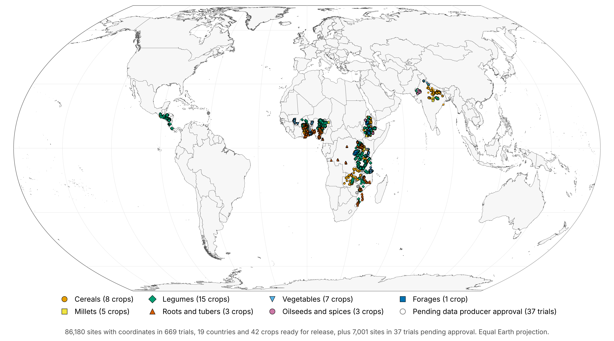

<!-- badges: start -->
[](https://doi.org/10.5281/zenodo.17112491)
[](https://www.repostatus.org/#active)
[](https://lifecycle.r-lib.org/articles/stages.html#stable)
[](https://creativecommons.org/publicdomain/zero/1.0/)
<!-- badges: end --> 

# Global multi-crop agricultural trial data supported by citizen science

The [triadic comparison of technologies (tricot)](https://doi.org/10.1007/s13593-023-00937-1) is a citizen science approach for testing technology options in their target environments, which has been applied to on-farm testing of crop varieties. ‘Triadic’ refers to the sets of three technology options that are compared by each participant. In the approach, participants are invited to test an anonymous set of three technologies (out of a larger number, generally between 5 to 20) randomly assigned. Between 2011 and 2025 the tricot approach was applied in more than 25 countries across Africa, Asia, Europe and Latin America with more than 30 crops.

---

## Crops and sites currently covered by the dataset

The map below shows the crops and trial sites that are currently available for public use. Each point represents a trial location, and the legend indicates the crop(s) associated with those sites. This visualization helps to quickly identify the regions and crops that are currently represented in the dataset.



## Find a dataset

[`datasets.csv`](datasets.csv) lists every trial, one row each, with crop, taxon, country, data producer, start and end dates, objective, number of participants, blocks and genotypes, collection moments, ranked traits, file name, file size and license. Start there, then open only the trial files you need from [`data/`](data).

## Data structure

Each trial is one JSON file in `data/`, named `<crop>-<study_id>.json`, with four components.

- **metadata** describes the study, dates, location extent, data producer, crop, participants, funders, genotypes and variables.
- **block_data** holds one row per participant (block), with jittered coordinates, planting dates and participant-level survey answers.
- **plot_data** holds one row per plot, trait and collection moment. Values are stored as text and read according to `value_type` (rank, integer, decimal, date, datetime, text, select one, select all that apply).
- **rank_analysis** holds Plackett-Luce log-worth estimates per collection moment and trait, with standard errors, quasi standard errors and quasi variances.

Every field is defined in [`metadata/data-dictionary.csv`](metadata/data-dictionary.csv), and [`metadata/tricot-trial.schema.json`](metadata/tricot-trial.schema.json) is the JSON Schema of a trial file.

``` text
├── metadata
│   ├── changelog (version, notes, software)
│   ├── identifier (concept DOI)
│   ├── license
│   ├── publication_year
│   ├── study (id, country ISO2, title, description, type, unit_of_analysis, objective, experimental_site)
│   ├── date (start, end as YYYY-MM-DD)
│   ├── geoLocation
│   │   ├── boundingBox (xmin, xmax, ymin, ymax)
│   ├── data_producer (name, identifier ROR, principal_investigator, email, program)
│   ├── crop (name, taxon)
│   ├── participants (total, men, women)
│   ├── funder [] (funderName, funderIdentifier, awardTitle, awardNumber)
│   ├── genotypes [] (genotype_name, role, release_year, crossing_year, target_trait, origin, remarks)
│   ├── variables [] (variable_name, description, ontology_id, value_type, controlled_vocabulary)
├── block_data []
│   ├── block_id
│   ├── longitude, latitude (jittered)
│   ├── <collection moment>_<variable> ...
├── plot_data []
│   ├── block_id, plot, genotype_name
│   ├── collection_moment, trait
│   ├── value, value_type
├── rank_analysis []
│   ├── collection_moment, trait, genotype_name
│   ├── estimate, SE, quasiSE, quasiVar
```

## Repository structure

``` text
├── data/        Trial files, one JSON per trial
├── docs/        Data paper for Scientific Data and the README maps
├── metadata/    Schema, data dictionary, project and per-partner metadata
├── script/      Export scripts and helpers, run by the data managers (see script/README.md)
├── datasets.csv Index of all trials
├── SKILL.md     Instructions for AI assistants using the data
├── AGENTS.md    Short instructions for AI agents using the data
├── MAINTAINERS.md Guide for the tricot data managers
├── NEWS.md      What each release added
```

## Use with AI assistants

This repository is the data layer of the [AI-ready documentation for tricot](https://github.com/AgrDataSci/ai-ready-documentation). Share that link with an AI assistant to reach the data together with the published evidence, protocols and analytical approaches, or use [`SKILL.md`](SKILL.md) on its own.

## Using the ranking data
This repository provides tricot on-farm ranking data in JSON. The plot_data table stores one row per plot evaluation (e.g., block_id, genotype_name, collection_moment, trait, value, value_type). To analyze rankings, filter rows to value_type == "rank", convert to sparse rankings with rank_tricot2(), and fit Plackett–Luce models.

``` r
library("jsonlite")
library("gosset")
library("PlackettLuce")

# Load one dataset
dat = fromJSON(
  "https://raw.githubusercontent.com/AgrDataSci/tricot-data/main/data/potato-88f82a3f073e.json"
)

# study metadata
dat$metadata$study

# Prepare and model rankings by trait × collection moment
R = dat$plot_data
R = R[R$value_type == "rank", ]
R$traitmoment = paste(R$collection_moment, R$trait, sep = " - ")

R = split(R, R$traitmoment)
R = lapply(R, function(x) {
  rank_tricot2(
    data  = x,
    items = "genotype_name",
    input = "value",
    id    = "block_id"
  )
})

mod = lapply(R, PlackettLuce)
```
For more information, check the [gosset package documentation](https://agrdatasci.github.io/gosset/).

## Report an error

The data are maintained by the tricot data managers. If something looks wrong, [open an issue](https://github.com/AgrDataSci/tricot-data/issues/new?template=data-error.md) naming the file, the field and the problem. Corrections are made in the export scripts and published in the next release.

## Citation

The dataset is archived on [Zenodo](https://doi.org/10.5281/zenodo.17112491). This DOI always resolves to the latest version.

> The dataset is dedicated to the public domain under [CC0 1.0](https://creativecommons.org/publicdomain/zero/1.0/). You can use it without restriction. Please cite it, and the publications named in each trial's metadata, so that the farmers, data producers and funders behind the trials get credit.

de Sousa, K., Laporte, M.-A., Abate, L., Abdulmalik, R. O., Abidin, E., Abolore, B., Achigan-Dako, E. G., Aglinglo, L. A., Aguilar, A., Angudubo, S., Arnaud, E., Assefa, T. M., Atieno, E., Ayenan, M., Barrios, M., Borman, G., Boukar, O., Brown, D., Carey, E., Chaves, N., … van Etten, J. (2025). Global multi-crop agricultural trial data supported by citizen science [Dataset]. Zenodo. https://doi.org/10.5281/zenodo.17112491

### BibTeX (dataset)

``` bibtex
@dataset{desousa_tricot_2025,
  author       = {de Sousa, Kauê and Laporte, Marie-Angélique and Abate, Legesse and Abdulmalik, Rekiya O. and Abidin, Erna and Abolore, Bello and Achigan-Dako, Enoch G. and Aglinglo, Lys Amavi and Aguilar, Amilcar and Angudubo, Stephen and Arnaud, Elizabeth and Assefa, Teshale M. and Atieno, Elly and Ayenan, Mathieu and Barrios, Mirna and Borman, Gareth and Boukar, Ousmane and Brown, David and Carey, Edward and Chaves, Néstor and Chase, Rachel and … and van Etten, Jacob},
  title        = {Global multi-crop agricultural trial data supported by citizen science},
  year         = {2025},
  publisher    = {Zenodo},
  doi          = {10.5281/zenodo.17112491},
  url          = {https://doi.org/10.5281/zenodo.17112491},
  note         = {Dataset}
}
```
