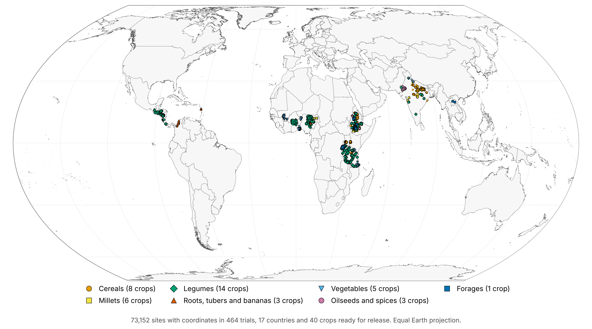

<!-- badges: start -->
[](https://doi.org/10.5281/zenodo.17112491)
[](https://www.repostatus.org/#active)
[](https://lifecycle.r-lib.org/articles/stages.html#stable)
[](https://creativecommons.org/publicdomain/zero/1.0/)
<!-- badges: end --> 

<a href="https://github.com/AgrDataSci/maniva"></a>

# Global multi-crop agricultural trial data supported by citizen science

The [triadic comparison of technology options (tricot)](https://doi.org/10.1007/s13593-023-00937-1) is a citizen science approach for testing technology options in their target environments, which has been applied to on-farm testing of crop varieties. ‘Triadic’ refers to the sets of three technology options that are compared by each participant. In the approach, participants are invited to test an anonymous set of three technologies (out of a larger number, generally between 5 to 20) randomly assigned. Between 2011 and 2025 the tricot approach was applied in more than 25 countries across Africa, Asia, Europe and Latin America with more than 30 crops.

---

## Crops and sites currently covered by the dataset

The map below shows the trial sites that are currently available for public use, coloured by crop group. Sites of the same trial within 10 km of each other are drawn as one point. The map uses the Equal Earth projection.



## Find a dataset

[`datasets.csv`](datasets.csv) is the finding aid. It lists every trial, one row each, with trial id, crop, taxon, country, data producer, start and end dates, type, management, objective, participants, sites, genotypes, collection moments, ranked traits, the `path` to fetch, file size and license. Start there, filter, then open only the files you need through their `path`. Never compose a file name yourself.

The current release holds 514 trials and 92,555 sites across 41 crops in 19 countries, from 20 data producers. Of these, 468 are farmer-managed tricot trials, 7 are consumer tests (4 of boiled sweetpotato in Ghana and Uganda, 3 of cassava eba in Nigeria and Cameroon), 5 are video-based product concept tests and 34 are researcher-managed mother trials of participatory varietal selection in India, linked to the tricot trials on the same genotypes. The release covers the 64 trials of the first release and adds trials from India, Ethiopia, Central America, Ghana, Nigeria, Laos, Tanzania, Kenya, Uganda, Mozambique, Colombia, Cameroon and Guadeloupe, all in the harmonised format described below.

## Data structure

Each trial is one JSON file at `data/<crop>/<crop>-<iso3>-<trial_id>.json`, for example `data/potato/potato-NGA-88f82a3f073e.json`. The trial id is the only identity of a trial. Trials run on ClimMob keep their ClimMob project id, and older trials from partner files have an id that ends in `v`. Crop and country in the name make a folder easy to scan, and `pvs` in the name marks researcher-managed companion data. Every file follows release schema v3.0 and has three parts.

- **metadata** describes the trial, its producer, contributors, crop, participants, genotypes, funders and every variable in the file.
- **site_data** has one row per site, the farm or household where a package of three genotypes was grown, with coordinates rounded to two decimals, administrative units as defined for the country (`adm1` to `adm5`, then `location` for the village) where recorded, planting dates and participant-level answers. Categorical answers have one spelling across trials, in English.
- **plot_data** is the long table of observations, one row per site, plot, collection moment and trait. Values are stored as text and read according to `value_type` (rank, numeric, date, categorical, multiple, or vs_local for the comparison with the farmer's own variety), with the `unit` where one applies. Measured values also carry `value_standard` and `unit_standard`, the same value in one unit per trait across trials (kg, kg/ha, cm). `moment_days` is the planned day of the collection moment and `moment_date` is the date it took place at the site, where recorded.

The files hold observations only. Model results such as Plackett-Luce estimates are not part of the release; fit them from the rankings in `plot_data` (see `SKILL.md`).

**Coordinates.** Site coordinates are rounded to two decimals, which places the published point within about 800 m of the recorded one. `metadata.location_privacy` states the method and the radius. This protects participants and keeps the points fit for climate and soil data.

**Companion data.** A tricot trial lists in `metadata.companions` the researcher-managed files with data on its genotypes, and those files point back through `metadata.companion_of`. The `file` in a link is relative to `data/`. Five groundnut trials from Tanzania link to on-station files that are not part of this release yet.

Site and plot rows link through `site_id`. `metadata.variables` lists every column of `site_data` and `plot_data` with its description, harmonised question id, Crop Ontology term, value type and unit. Rankings are the position of each genotype within its site, where 1 is best. Traits, site variables and collection moments have one standard name per concept across trials, after the review by Robert J. Hijmans. `trait_original` keeps the question code of the trial, `metadata.variables[].original_name` the name of a site variable before the standard name, and `standard_moment` in `metadata.study.collection_moments` gives the stage of each moment.

**Concept tests.** Five files have `type` "concept testing" in `datasets.csv`. Four are by CIMMYT market intelligence, maize in Kenya and Uganda and groundnut and sorghum in Tanzania. They are the replication data of the market intelligence publications named in their metadata, and hold more variables than the versions CIMMYT deposited in its Dataverse. One is by CIAT and CIRAD, cassava in the Caribbean region of Colombia. Each participant watched videos of three product concepts and named the one they would most and least like to acquire. The file has the same parts as a trial file. The items in `metadata.genotypes` are product concepts, descriptions of seed products that do not exist yet, with `role` "product concept", and no crop was grown. A ranking is a stated preference about a description. The two maize files also hold the household survey of the study, 30 variables on the household, its land, income, seed and what it did with the last harvest, with the interview point rounded to two decimals. The cassava file holds the department and municipality, the kind of cassava the farmer grows (sweet, industrial or both) and its area, the concept the farmer would plant, the reasons given for the choices, translated from Spanish to English, and the farm or interview point rounded to two decimals.

**One field trial, two files.** The Nigeria cassava trials `ce958b0b5b5c` (Tricot23) and `ad2251c812c4` (DyadsTri23) are the same field trial of 2023 to 2025. The socioeconomic team interviewed the man and the woman of each household separately, one in each ClimMob project. The plots, varieties and field measurements are shared, so do not count the two files as independent field observations.

**Small trials.** 16 farmer-managed trials have fewer than 15 sites, 136 sites in all. A trial of that size cannot rank its varieties on its own. Treat it as a record of which varieties were tested where, or pool it with other trials of the same crop and programme that share varieties, as the ISSD trials of Ethiopia do. Seven of these trials, from the GEF project in India, share no variety with any other trial and are descriptive only. They stay in the release because they hold three crops (black gram, rice bean and small millets) and about 140 varieties that no other trial has. To leave small trials out, filter [`datasets.csv`](datasets.csv) on `n_sites`. The 22 mother trials of participatory varietal selection with fewer than 15 sites are small by design, since researchers run them on a few plots.

**Yield.** `yield_plot` is the weight harvested from the plot and `yield` the yield per area in kg/ha. A `yield` with the flag `derived` was computed from the plot weight and the plot area. Where the trial reported no plot area, the area comes from the tricot protocol for the crop, and the yield also carries `plot_area_assumed`. Filter on that flag to keep only yields from reported or published plot areas. `site_data.plot_area_source` says where each plot area comes from.

``` text
├── metadata
│   ├── schema_version                      "3.0"
│   ├── changelog (version, date, notes, software)
│   ├── identifier                          concept DOI, https://doi.org/10.5281/zenodo.17112491
│   ├── license                             CC0-1.0
│   ├── study
│   │   ├── id                              trial id, the identity of the file
│   │   ├── code, title, description        ClimMob project code and the trial as described by the producer
│   │   ├── type, objective, experimental_site, unit_of_analysis
│   │   ├── country_iso2, country_iso3, country_name
│   │   ├── source_platform                 ClimMob version the trial came from
│   │   ├── collection_moments (moment, moment_days, standard_moment, visit, assessor)   moment_days is the planned day, counted from the start of the trial
│   │   ├── management, season, design      companion data only (researcher-managed)
│   ├── date (start, end as YYYY-MM-DD)
│   ├── geo_location
│   │   ├── boundingBox (xmin, xmax, ymin, ymax)
│   ├── location_privacy (method, radius_m, admin_names)   coordinates rounded to two decimals, radius 800 m
│   ├── admin_levels (adm1 ... adm5)         what each administrative level is in the country, for example region, zone, woreda
│   ├── data_producer (name, identifier ROR, principal_investigator, email, program, partner)
│   ├── contributors (name, orcid, affiliation, contributorType)
│   ├── crop (name, taxon)
│   ├── participants (total, women, men, not_stated)
│   ├── genotypes (genotype_name, role, release_year, crossing_year, origin, target_trait, remarks)
│   ├── funder (funderName, funderIdentifier ROR, awardTitle, awardNumber)
│   ├── companions                          tricot trials only, the companion files with data on its genotypes
│   ├── companion_of                        companion data only, the tricot trials the file relates to
│   ├── variables
│   │   ├── level                           site or plot
│   │   ├── variable_name, original_name, description
│   │   ├── harmonised_id, ontology_id      harmonised question id and Crop Ontology term
│   │   ├── value_type, unit, controlled_vocabulary
├── site_data                               one row per site
│   ├── site_id                             trial id plus package number
│   ├── trial_id, country_iso3, country, crop
│   ├── longitude, latitude                 WGS84, rounded to two decimals
│   ├── geo_source, geo_uncertainty (metres), geo_flag
│   ├── adm1 ... adm5, location             administrative units of the country (metadata.admin_levels), then the village
│   ├── planting_date, plot_area, plot_area_source, ...    and the survey variables listed in metadata.variables
├── plot_data                               one row per site, plot, moment and trait
│   ├── site_id, plot                       plot is the package letter (A, B, C)
│   ├── genotype_name                       null where the variety of the plot is not in the data
│   ├── collection_moment, moment_days      moment and its planned day, the same for every site
│   ├── moment_date                         date the moment took place at the site, null when not recorded
│   ├── trait, trait_id, trait_original
│   ├── value, value_type, unit, flag
│   ├── value_standard, unit_standard       measured values only, the value in the standard unit of the trait
```

Every field is defined in [`metadata/data-dictionary.csv`](metadata/data-dictionary.csv), and [`metadata/tricot-trial.schema.json`](metadata/tricot-trial.schema.json) is the JSON Schema of a trial file, release schema v3.0.

## Repository structure

``` text
├── data/           Trial files, one folder per crop, one JSON per trial
├── docs/           Data paper for Scientific Data and the README maps
├── metadata/       Schema, data dictionary, project and per-partner metadata
├── datasets.csv    Index of all trials, with the path to each file
├── SKILL.md        Instructions for AI assistants using the data
├── AGENTS.md       Short instructions for AI agents using the data
├── MAINTAINERS.md  Guide for the tricot data managers
├── NEWS.md         What each release added
├── script/         build-parquet.py, which builds the parquet tables attached to each release
```

## Use with AI assistants

This repository is the data layer of the [maniva](https://github.com/AgrDataSci/maniva), the AI-ready documentation for tricot. Share that link with an AI assistant to reach the data together with the published evidence, protocols and analytical approaches, or use [`SKILL.md`](SKILL.md) on its own.

## Using the ranking data

To analyse rankings, read the file path from `datasets.csv`, keep the `plot_data` rows where `value_type` is `rank`, convert them to rankings with `gosset::rank_tricot2()`, and fit Plackett-Luce models.

``` r
library("jsonlite")
library("gosset")
library("PlackettLuce")

base = "https://raw.githubusercontent.com/AgrDataSci/tricot-data/main/"

# Find the trial in the index
idx = read.csv(paste0(base, "datasets.csv"))
path = idx$path[idx$trial_id == "88f82a3f073e"]

# Load the trial
dat = fromJSON(paste0(base, path))

# Study metadata, and what adm1 to adm5 are in the country of the trial
dat$metadata$study
dat$metadata$admin_levels

# Sites, with the standard column names of schema 3.0
site = dat$site_data
head(site[, c("site_id", "country", "crop", "adm1", "adm2", "location",
              "longitude", "latitude", "geo_source", "farmer_gender", "planting_date")])

# Rankings by collection moment and trait.
# trait is the standard name, the same across trials. trait_original is the
# question code of the trial, and keeps apart two questions on the same trait.
R = dat$plot_data
R = R[R$value_type == "rank", ]
R$traitmoment = paste(R$collection_moment, R$trait, R$trait_original, sep = " - ")

R = split(R, R$traitmoment)
R = lapply(R, function(x) {
  rank_tricot2(
    data  = x,
    items = "genotype_name",
    input = "value",
    id    = "site_id"
  )
})

mod = lapply(R, PlackettLuce)

# Measured values. value_standard is the value in the standard unit of the
# trait (unit_standard), the same unit in every trial.
Y = dat$plot_data
Y = Y[Y$trait == "yield" & Y$value_type == "numeric", ]

# A yield flagged "derived" was computed from the plot weight and the plot area.
# "plot_area_assumed" marks a protocol plot size, not a reported one. Drop these
# to keep only yields from reported or published plot areas.
Y = Y[!grepl("plot_area_assumed", Y$flag), ]
Y$yield_kg_ha = as.numeric(Y$value_standard)

aggregate(yield_kg_ha ~ genotype_name, data = Y, FUN = median)
```

### Moving code from schema 2.1 to 3.0

Code written for the earlier files needs these changes.

| In schema 2.1 | In schema 3.0 |
|---|---|
| `site_data$country_name`, `site_data$crop_name` | `site_data$country`, `site_data$crop` |
| `coordinate_source`, `coordinate_uncertainty_m`, `coordinate_flag` | `geo_source`, `geo_uncertainty`, `geo_flag` |
| `adm1`, `adm2`, `adm3` as region, district, village | `adm1` to `adm5` as defined for the country in `metadata$admin_levels`, and `location` for the village |
| `gender`, `plot_area_m2` and other site columns | standard names such as `farmer_gender` and `plot_area`. The earlier name of each column is in `metadata$variables$original_name` |
| trait names such as `overallchar` or `yieldperse` | standard names such as `overall_performance`, `yield_plot` (plot weight) and `yield` (kg/ha). The question code of the trial stays in `trait_original` |
| `value` and `unit` for measurements | unchanged, with `value_standard` and `unit_standard` added. Use these to combine trials |
| one flag in `flag` | one or more flags separated by `;`, so test with `grepl()` and not with `==` |
| collection moment labels | unchanged, with `standard_moment` added in `metadata$study$collection_moments` |

The table and column structure is the same. `plot_data` is still one row per site, plot, collection moment and trait, and links to `site_data` through `site_id`.
For more information, check the [gosset package documentation](https://agrdatasci.github.io/gosset/).

## Analysis tables (parquet)

Each release also carries every trial in three parquet tables, built from the JSON by [`script/build-parquet.py`](script/build-parquet.py):

| Table | One row per | Source in the JSON |
|---|---|---|
| [`plots.parquet`](https://github.com/AgrDataSci/tricot-data/releases/latest/download/plots.parquet) | plot, collection moment and trait | `plot_data` |
| [`sites.parquet`](https://github.com/AgrDataSci/tricot-data/releases/latest/download/sites.parquet) | site | `site_data` |
| [`variables.parquet`](https://github.com/AgrDataSci/tricot-data/releases/latest/download/variables.parquet) | trial and variable | `metadata.variables` |

Columns are those of the JSON plus `trial_id`, so `rank_tricot2()` reads the plots table as it reads `plot_data`. Use them to pool trials or to filter on site variables. The JSON stays the full record, with the metadata the tables leave out.

## Report an error

The data are maintained by the tricot data managers. If something looks wrong, [open an issue](https://github.com/AgrDataSci/tricot-data/issues/new?template=data-error.md) naming the file, the field and the problem. Corrections are made in the data managers' processing repository and published in the next release.

## Citation

The dataset is archived on [Zenodo](https://doi.org/10.5281/zenodo.17112491). This DOI always resolves to the latest version.

> The dataset is dedicated to the public domain under [CC0 1.0](https://creativecommons.org/publicdomain/zero/1.0/). You can use it without restriction. Please cite it, and the publications named in each trial's metadata, so that the farmers, data producers and funders behind the trials get credit.

de Sousa, K., Laporte, M.-A., Abate, L., Abdulmalik, R. O., Abidin, E., Abolore, B., Achigan-Dako, E. G., Adonia, J., Agawini, J., Aglinglo, L. A., Aguilar, A., Ahmed, H. O., Andrade Lopez, R. S., Angudubo, S., Arnaud, E., Asirifi, O., Assefa, T. M., Atieno, E. O., Atieno, M., Attamah, P., … van Etten, J. (2025). Global multi-crop agricultural trial data supported by citizen science [Dataset]. Zenodo. https://doi.org/10.5281/zenodo.17112491

### BibTeX (dataset)

``` bibtex
@dataset{desousa_tricot_2025,
  author       = {de Sousa, Kauê and Laporte, Marie-Angélique and Abate, Legesse and Abdulmalik, Rekiya O. and Abidin, Erna and Abolore, Bello and Achigan-Dako, Enoch G. and Adonia, Joseph and Agawini, Jonathan and Aglinglo, Lys Amavi and Aguilar, Amilcar and Ahmed, Hauwa Oziohu and Andrade Lopez, Robert Santiago and Angudubo, Stephen and Arnaud, Elizabeth and Asirifi, Ophelia and Assefa, Teshale M. and Atieno, Elly Ouma and Atieno, Mary and Attamah, Patrick and Ayenan, Mathieu and … and van Etten, Jacob},
  title        = {Global multi-crop agricultural trial data supported by citizen science},
  year         = {2025},
  publisher    = {Zenodo},
  doi          = {10.5281/zenodo.17112491},
  url          = {https://doi.org/10.5281/zenodo.17112491},
  note         = {Dataset}
}
```
