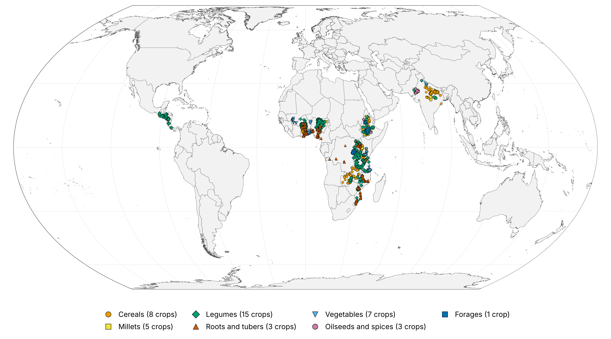
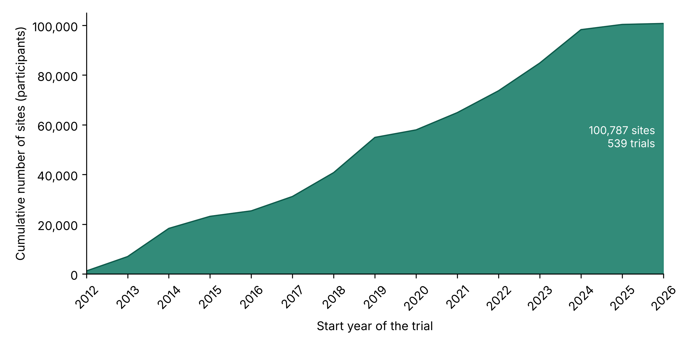

*Working draft for submission to Scientific Data ([https://www.nature.com/sdata/](https://www.nature.com/sdata/)). Version of 5 November 2026. Items marked XX are placeholders to resolve before submission.*

Kauê de Sousa^1,2^, Marie-Angélique Laporte^1^, Legesse Abate^3^, Rekiya O. Abdulmalik^4^, Erna Abidin^5^, Bello Abolore^6^, Enoch G. Achigan-Dako^7^, Joseph Adonia^8^, Lys Amavi Aglinglo^9^, Amilcar Aguilar^10^, Stephen Angudubo^1^, Elizabeth Arnaud^1^, Teshale M. Assefa^11^, Elly Ouma Atieno^12^, Mathieu Ayenan^9^, Mirna Barrios^10^, Gareth Borman^3^, Ousmane Boukar^6^, David Brown^13^, Antony Bujiku^8^, Jill E. Cairns^17^, Edward Carey^5^, Rachel Chase^1^, Néstor Chaves^14^, Allan Coto^15^, Almendra Cremaschi^1^, Harouna Coulibaly^16^, Roma Rani Das^17^, Happy Daudi^17^, Maryam Dawud^18^, Danfing dit Youssouf Diarra^16^, Aminata Dolo^16^, Hugo Dorado-Betancourt^3^, Gospel Edughaen^6^, James Ellison^19^, Carlo Fadda^1^, Harish Gandhi^17^, Sanusi Gaya Mohammed^20^, Yosef Gebrehawaryat Kidane^1^, Marvin Gomez Cerna^21^, Arnab Gupta^3^, Mohammed Hassena Beko^3^, Juan Carlos Hernández^22^, Aristide Carlos Houdegbe^7^, Paula Iragaba^23^, Marit Jørgensen^24^, Edith Kadege^8^, Sylvia Kalemera^11^, Fadhili Kasubiri^11^, Emmanuel Katamba^8^, Robert Kawuki^23,25^, Michael Kilango^8^, Aishi Kileo^8^, Basazen Lakew^26^, Emmanuel V. Laswai^8^, Muhammad Lawan Umar^27^, Eric C. Legba^9^, Brandon Madriz^15^, Tessy Ugo Madu^28^, Dickson Malulu^8^, Rhys Manners^6^, Marilyn Manrow-Villalobos^15^, Zamira Matumbo^8^, Harriet Mawia^17^, Julius Mbiu^8^, Mercy Mbugua^17^, Thiago Mendes^12^, Dejene K. Mengistu^1^, Anna Mlaki^9^, Hesam Mousavi^2^, Mukani Moyo^12^, James Mugo^12^, Kalkidan Ayele Mulatu^11^, Sognigbé N'Danikou^9^, Mabel Nabateregga^2^, Ganga Rao V. P. R. Nadigatla^17^, An Ritah Nanyonjo^23^, Athanase Nduwumuremyi^29^, Magne Neby^2^, An Notenbaert^11^, Jean Claude Nshimiyimana^12^, Shadrack Otieno Nyawade^12^, Hyacinthe Nyirahabimana^3^, Christopher Ochieng Ojiewo^17^, Olamide Olaosebikan^6^, Patrick Obia Ongom^6^, Samuel Onwuka^28^, Richard Oteng-Frimpong^30^, Colette Ouidyam Ouedraogo^9^, Abhishek Rathore^17^, Juan Carlos Rosas^31^, Placide Rukundo^12^, Pieter Rutsaert^17^, Abdou Mouizz B. Salaou^7^, Mirjam Schaap^3^, Abdul Shango^9^, Kalpana Sharma^12^, Neeraj Sharma^12^, Milindi Sibomana^19^, Amadou Sidibe^16^, Silvère Fernand Sohindji^7^, Svein Øivind Solberg^2^, Reuben Ssali^12^, Jonathan Steinke^1^, Jose Gabriel Suchini^10^, Dèdéou Apocalypse Tchokponhoue^7^, Béla Teeken^6^, Theophilus Kwabla Tengey^30^, Hale Ann Tufan^13^, Elysé Tuyishime^19^, Jacob Ulzen^1^, Joost van Heerwaarden^3^, Maarten van Zonneveld^12^, Mary Yeye^27^, Brayden Youngberg^1^, Mainassara Zaman-Allah^17^, [additional authors from the data producers of every trial file, to be confirmed before submission]^XX^, Jacob van Etten^1^

^1^ Bioversity International, Rome, Italy\
^2^ University of Inland Norway, Elverum, Norway\
^3^ Wageningen University & Research, Wageningen, The Netherlands\
^4^ Ahmadu Bello University, Zaria, Nigeria\
^5^ Reputed Agriculture 4 Development Stichting and Foundation, Kumasi, Ghana\
^6^ International Institute of Tropical Agriculture, Ibadan, Nigeria\
^7^ University of Abomey-Calavi, Abomey-Calavi, République du Benin\
^8^ Tanzania Agricultural Research Institute, Dodoma, Tanzania\
^9^ World Vegetable Center, Tainan, Taiwan\
^10^ Centro Agronómico Tropical de Investigación y Enseñanza, Turrialba, Costa Rica\
^11^ International Center for Tropical Agriculture, Cali, Colombia\
^12^ International Potato Center, Lima, Peru\
^13^ Cornell University, Ithaca, USA\
^14^ Universidad de Costa Rica, San José, Costa Rica\
^15^ MrBot Software Solutions, Cartago, Costa Rica\
^16^ Institut d’Economie Rurale, Bamako, République du Mali\
^17^ International Maize and Wheat Improvement Center, Texcoco, México\
^18^ Lake Chad Research Institute, Borno, Nigeria\
^19^ One Acre Fund, Kakamega, Kenya\
^20^ Bayero University, Kano, Nigeria\
^21^ Fundación para la Investigación Participativa con Agricultores de Honduras, La Ceiba, Honduras\
^22^ Instituto Nacional de Innovación y Transferencia en Tecnología Agropecuaria, San José, Costa Rica\
^23^ National Crop Resources Research Institute, Namulonge, Uganda\
^24^ Norwegian Institute of Bioeconomy Research, Ås, Norway\
^25^ World Coffee Research, Portland, USA\
^26^ Ethiopian Biodiversity Institute, Addis Ababa, Ethiopia\
^27^ Institute for Agricultural Research, Kaduna, Nigeria\
^28^ National Root Crops Research Institute, Umudike, Nigeria\
^29^ Rwanda Agriculture and Animal Resources Development Board, Huye, Rwanda\
^30^ Savanna Agricultural Research Institute, Tamale, Ghana\
^31^ Zamorano Pan-American Agricultural School, Francisco Morazán, Honduras\
^XX^ Affiliations of the additional authors

# Abstract

We present the largest open dataset of decentralised on-farm agricultural experiments, produced with the tricot approach (triadic comparisons of technology options) by 27 research organisations across 20 countries in Africa, Asia and Central America. The release holds 669 trial files covering 42 crops, 100,787 farmer-managed sites and 3.28 million plot-level observations, of which 2.44 million are rankings and 0.51 million are measurements, collected between 2012 and 2026. Each trial is published as one self-describing JSON file that carries its design, its sites with displaced coordinates, its observations, its genotypes and its full provenance, with producer, contributors and funder identified through persistent identifiers. Trait names are harmonised across trials and mapped to the Crop Ontology where terms exist. Researcher-managed companion data from the same genotypes, 130 on-station and mother trials, are linked to the tricot trials they complement. The data are released under CC0 1.0 on GitHub and archived on Zenodo under a permanent concept DOI. The dataset supports research on farmer preferences, genotype by environment interaction, climate adaptation, variety release and seed systems, and it is built so that people and AI agents fetch, filter and reuse it without accounts or tooling.

**Keywords.** citizen science, on-farm testing, tricot approach, participatory variety evaluation, open data, FAIR data, crop improvement, seed systems

# Background and summary

For fifteen years the tricot approach has grown through partnership. National research institutes, CGIAR centres, NGOs, seed companies and universities in 20 countries ran on-farm trials with a shared method and the ClimMob platform ([https://climmob.net/](https://climmob.net/)), and farmers ranked 42 crops on more than 100,000 farms. Each trial served its partner's decision on variety release, seed system development or breeding priorities [@vanEtten2019; @Brown2022; @Nanyonjo2024; @Daudi2026]. This release brings those trials together as one open resource for the breeding and seed system community and beyond.

The dataset is reusable at this scale because every trial is published as one self-describing file in a common schema, with the credit of the organisation that produced it. That design is what let 45 organisations, 27 of them data producers, release 539 farmer-managed trials and 100,787 sites under CC0, together with 130 researcher-managed companion trials on the same genotypes. Methods explains how trials collected in different formats and languages became one schema without losing provenance or exposing farmers. Data Records describes the files and their coverage. Usage Notes explains how people and AI agents fetch the data and how credit flows back to the producers.

```{r map, echo = FALSE, out.width = "100%", fig.cap = "Trial sites in the dataset, by crop group. Sites of the same trial within 10 km of each other are shown as one point at the centre of their cluster. Equal Earth projection, EPSG:8857. Administrative boundaries from Natural Earth. The authors remain neutral with regard to jurisdictional claims in maps."}

```

The data come from the tricot approach, proposed in 2011 for large-scale, decentralised citizen science in agriculture [@vanEtten2011; @vanEtten2016]. Options from a larger pool are allocated to participants in connected incomplete blocks of three. A farmer receives three coded seed lots, grows them side by side under local management and reports which performed best and worst for each trait. Because the triads overlap, the partial rankings of many farmers form one comparison network, and the relative performance of every option is estimated with Plackett-Luce models although nobody evaluates the full set [@vanEtten2019; @Turner2020; @deSousa2024]. Tricot trials have shown that these distributed observations support inference across environments [@vanEtten2019], predict across-season performance better than station-trained genomic models [@deSousa2021], extend to consumer tests and product concepts [@Moyo2021; @Donovan2025], and aggregate into reliable estimates although each farmer's ranking is imperfect [@Steinke2017; @vandeGevel2020]. Each trial was designed, run and owned by the organisation that needed the answer, under its own project and funder, on successive versions of ClimMob or in partner files [@Quiros2024; @deSousa2024]. Bringing them together meant harmonising the formats, languages and conventions each partner chose for its own question, which is the work this release documents.

Three features follow from the design and set the dataset apart from the trial data breeding programmes usually release. It was built from the bottom up, so the trust of the producers is written into the files. Each trial carries its producer with a ROR identifier, its principal investigator, its contributors and its funder, and credit travels with the data wherever they go. It is wide rather than deep. One trial of 150 farms says little on its own, while several hundred trials on 42 crops across 20 countries let an analyst ask which varieties perform where, how preferences differ between women and men, how performance responds to climate and whether on-farm and on-station results agree. And it is FAIR in full [@Wilkinson2016] for people and for AI agents alike. One index lists every trial with the path to fetch it, one JSON file per trial describes itself completely, and nothing requires an account, a token or a database client.

```{r cumulative, echo = FALSE, out.width = "100%", fig.cap = "Cumulative growth of the farmer-managed tricot trials by start year. The area gives the cumulative number of sites (participants) of all 539 trials, 100,787 in total [XX, confirm the 18 estimated years in `metadata/questions/`]."}

```

This release is the production version of the dataset. A pilot release in 2025 tested the format on 62 trials from six African countries, and the data described here replace it, so users should work with this release. It harmonises trials collected with every version of ClimMob since 2012 and partner files into one schema, one naming rule and one licence, and sets the standard for future publications of tricot data from ClimMob. It is also the first release that reaches beyond Africa, to India and Central America, where tricot began.

# Methods

## The tricot design

The unit of the design is the set of three technology options evaluated by one participant. The options are most often crop varieties and breeding lines, and sometimes food products, agronomic practices or product concepts. The pool usually holds 8 to 12 comparable options and never fewer than two. In this release the median trial compares 10 genotypes and the largest 48. Each participant receives one incomplete block of three, which keeps the entry threshold low in land, time and training. Blocks are allocated at random by ClimMob in a sequentially balanced way, so that each option appears at roughly equal frequency and every village receives a balanced set even when distribution stops early [@vanEtten2016; @Quiros2024]. Packages are coded A, B and C and the identity of the options is revealed only after the data are collected, to prevent bias toward familiar names.

Participants grow the three options at the same time in adjacent plots of equal size, under their own management, which maximises external validity. At defined crop stages they record on pictorial observation cards which option is best and which is worst for each trait, for instance germination, vigour, pest and disease resistance, drought tolerance, yield, taste and marketability, and for overall preference. Many trials also compare each option with the farmer's own local variety, and a growing share records measured traits such as plot yield or days to maturity. Field agents, usually extension officers, digitise the cards with the ODK Collect app and submit them to ClimMob, where the project owner keeps full rights over the data [@Quiros2024]. Ranks are stored as the position of each option within the site, 1 being best, and the middle rank is inferred from the best and worst answers. Rankings are analysed with Plackett-Luce models, which estimate for each option the probability of outranking the others [@Turner2020; @deSousa2025gosset], and with model-based recursive partitioning to find the climatic, geographic or socio-economic covariates that change the ranking [@vanEtten2019; @Zeileis2008].

## Sources of the data

The release combines four kinds of sources (Table 1). ClimMob projects were exported with their project metadata, registration survey, data collection forms and package allocation, or recovered from curated spreadsheets prepared for earlier publications [@vanEtten2019; @Brown2022]. Partner files cover trials run with the tricot design outside ClimMob, among them the national on-farm trials of Integrated Seed Sector Development Ethiopia, the NextGen Cassava trials in Nigeria and Tanzania and the consumer and concept tests run with video-based ranking tools [@Donovan2025; @Olaosebikan2023]. Researcher-managed companion data come from breeding databases and spreadsheets of the same programmes, 96 on-station breeding trials of cassava in Nigeria and groundnut in Tanzania and 34 participatory varietal selection mother trials of bread wheat and rice in India, which evaluate the same genotypes under researcher control.

**Table 1. Sources of the trial files.**

| Source platform | Trial files | Sites | Years |
|---|---|---|---|
| ClimMob projects (platform exports and curated spreadsheets) | 526 | 89,901 | 2012 to 2026 |
| Partner spreadsheets and video-based ranking surveys (tricot design outside ClimMob) | 13 | 10,886 | 2013 to 2025 |
| Breeding database exports and PVS spreadsheets (researcher-managed companion data) | 130 | 596 | 2011 to 2023 |
| Total | 669 | 101,383 | 2011 to 2026 |

## From source to release file

Two objections meet any pooled on-farm dataset. The trials are not comparable, and the farmers' data are not protected. The pipeline answers both first, then takes care of identity, direction, credit, companion data and review. It runs as one command, kept under version control in the private working repository of the data managers, and rebuilds every release file from its source, so nothing in the published files is edited by hand. Each step has a decision record that states the question, the method, the alternatives rejected and what the result does and does not support. The records are published with the data so that a reader, or an AI agent, can judge whether a choice fits their own question.

**Harmonisation of traits and variables.** Every question asked in a trial was mapped to a canonical question in a harmonised question library of 414 entries that the protocols team maintains for all tricot crops [@Cremaschi2026]. The published trait name is the cleaned canonical code, so a yield ranking from Nicaragua in 2014 and one from Rwanda in 2024 share one name and one identifier. The label as asked is preserved in `trait_original`, and the identifier in `trait_id`, so every harmonised name traces back to its source. Where a Crop Ontology term exists for the crop and trait, its identifier is attached to the variable definition [@Pietragalla2024]. Labels with no canonical match keep an English name and an empty identifier, and are listed as open questions for the producer.

**Personal data.** Names, relatives' names, phone numbers, device identifiers, photographs, enumerator identities and free text are never exported. Administrative names and local variety names are kept. Gender and age are published as categories. Coordinates are checked against the national boundary, and points outside the country, with swapped axes or a flipped sign are removed and flagged. Every site coordinate is then displaced to a random point within 1,500 m, reproducibly per site id, and redrawn if it leaves the country. Sites published in the 2025 pilot release keep their coordinates so that no site receives two independent displacements. Sites without a coordinate take the mean of other located sites in the same village or district before displacement, with the source and the spread of the pool recorded in `coordinate_source` and `coordinate_uncertainty_m`. In this release 86,180 sites carry a point and 15,192 do not, the latter mostly consumer and concept tests and early India trials that recorded no village name.

**Identifiers.** The trial identifier is the only identity of a trial. Current ClimMob projects keep their 12-character hexadecimal project id. Older trials receive the first 11 hexadecimal characters of the MD5 hash of the country code and the original project code, followed by the letter v. The id has the same length and alphabet as a current id, cannot collide with one and reproduces itself on every run, which is how duplicates across sources were found. Sites are identified as trial id plus package number, and plots as the package letter A, B or C.

**Direction of rankings.** Some legacy forms asked which option was worst in the first column and best in the second, and some traits, such as faster maturity, can be valued in either direction. A check compares, at every site, the option ranked best for a trait with the option ranked best overall. Traits farmers value agree with the overall choice well above chance, and the median agreement of a trait across all trials describes how it normally behaves. A trait that agrees elsewhere but, in one trial, is the overall worst on more than half of at least 40 sites is reversed and every affected row is flagged `direction_inverted`. Ten trait and trial pairs were reversed. The same check exposed three bread wheat trials from India in 2014 whose answers are shifted across columns and cannot be repaired without the paper forms. They are published with a `consistency_warning` in their metadata.

**Producers, contributors and funders.** Where the source recorded no producer, the principal investigator of the ClimMob project and the project code decide, with the confidence and the evidence recorded in a reviewed table. An inferred producer carries an `attribution` note in the file, so a reader tells it from a stated one. Organisations were resolved against the Research Organization Registry; 20 of the 27 producers have a ROR identifier. Contributors follow the DataCite contributor types, with the authors of the publication that first used the data as project members, the person who curated the data as data curator and the data managers as such. Funders carry the award title and number where known. 204 trials name their funder, the largest being the CGIAR Research Program on Climate Change, Agriculture and Food Security (116 trials), the Gates Foundation (49), the Global Environment Facility (22), Norad (21), BMZ (20), SDC (20) and USAID (18).

**Companion data.** Researcher-managed trials on the same genotypes are published in the same schema with `pvs` or `station` in the file name and `management = researcher-managed` in the index. Each companion file lists in `metadata.companion_of` the tricot trials it relates to, and each tricot file lists in `metadata.companions` the companion files that carry data on its genotypes, with the shared genotype names. Measurements made on genotypes outside the trial design, such as laboratory assays of a food product, go to a `genotype_data` table in the tricot file itself. The three tables share the same observation columns, so an analyst joins them on `genotype_name` to fit models with item covariates.

**Review before release.** The processed files were reviewed as a whole before this release. Variable names were cleaned of question identifiers, genotype names of crop prefixes, spellings merged within trials, taxa given one spelling per crop and placeholders set to null. Every open question that the data could answer was answered and marked as decided, 176 proposed answers were sent to the producers for confirmation and 104 questions remain open, mostly release years of varieties, author lists, plot sizes and units. Forty further trials with 8,571 sites were processed but held back pending the approval of their producers. They will enter the next version.

## Standard operating procedures

Most trials in this release predate the first published collection of tricot standard operating procedures, released in 2026 with crop-specific protocols for 20 crops, an abbreviated sweetpotato protocol and the core question library [@Cremaschi2026]. The harmonised question library used here is the same one those protocols are built on, so trials run under the SOPs from 2026 onwards enter the dataset without further mapping. About 80 percent of current ClimMob trials already follow an SOP, and the data structure described here is what those SOPs produce. In both directions the protocols and the data share trait definitions, identifiers and Crop Ontology terms, which is what lets on-farm rankings sit beside on-station measurements in breeding systems [@Selby2025; @Pietragalla2024].

# Data Records

The release is published on GitHub at AgrDataSci/tricot-data and archived on Zenodo under the concept DOI 10.5281/zenodo.17112491 [@deSousa2025data]. The concept DOI always resolves to the latest version. The version DOI of this release, [10.5281/zenodo.XX], identifies the exact files described in this Data Descriptor. The GitHub release is tagged with the same version, and the Zenodo record holds the full data, never only a link. All files are released under CC0 1.0.

**Layout.** `datasets.csv` at the repository root is the finding aid, one row per trial with the trial id, crop and taxon, country, data producer, start and end dates, trial type and management, objective, numbers of participants, sites, genotypes and observation rows, the collection moments, the ranked traits, the size in megabytes, the licence and the path to fetch. Trial files sit in `data/<crop>/` and are named `<crop>-[kind-]<iso3>-<trial_id>.json`, where `kind` is `pvs` or `station` for companion data. Crop, country and year do not identify a trial, 313 of the 366 legacy files share all three with another file, so the trial id closes every name and no user composes a file name by hand. `metadata/` holds the JSON Schema, the data dictionary and the DataCite metadata of the release, `decisions/` the decision records of the pipeline, and `docs/` the map and this paper. The release is 1.2 GB of minified JSON. A single trial file is read with any JSON parser, and a user fetches the five trials they need, not the whole set.

**File structure.** Every trial file follows the same release schema with five parts (Table 2). `metadata` describes the trial, `site_data` has one row per site, `plot_data` is the long table of observations, `genotype_data` holds measurements on genotypes outside the trial design and `rank_analysis` is reserved for Plackett-Luce estimates. Site and plot rows link through `site_id`, genotype rows through `genotype_name`, and `metadata.variables` lists and describes every column of the three tables with its harmonised question id, Crop Ontology term, value type and unit. Every file states its schema version, the version and date of the release, the export script and interpreter that produced it, the concept DOI and the licence, so a file found anywhere identifies the dataset it belongs to.

**Table 2. Organisation of the trial files.**

| Component | Record unit | Principal contents |
|---|---|---|
| metadata | One object per trial | Trial id, code, title, type, objective, source platform and collection moments; start and end dates; bounding box and location privacy method; data producer with ROR id, principal investigator and programme; contributors with ORCID and DataCite type; crop and taxon; participants by gender; genotypes with role, release year and origin; funders with award; links to companion files; one definition per variable with harmonised id, ontology term, value type and unit; changelog |
| site_data | One row per site (farm, household or station plot) | site_id, trial id, country, crop, displaced longitude and latitude with source, uncertainty and flag, adm1 to adm3, planting and harvest dates, plot area, registration and survey variables |
| plot_data | One row per site, plot, collection moment and trait | site_id, plot (A, B, C or station plot), genotype_name, collection moment and days after planting, trait, trait_id, trait_original, value, value_type (rank, numeric, categorical, date, vs_local, multiple), unit, flag |
| genotype_data | One row per genotype, trait and replicate | Measurements made outside the trial design, such as laboratory assays of the product |
| rank_analysis | One row per genotype, trait and moment | Plackett-Luce estimates, empty until fitted by the data managers |

**Coverage.** The dataset holds 669 trial files from 20 countries and 42 crops, produced by 27 organisations (Figure 1, Table 3, Supplementary Table S1). The 539 farmer-managed tricot trials comprise 527 on-farm variety trials, 8 consumer tests and 4 concept tests, with 100,787 sites, each the farm or household of one participant, and 3.26 million observation rows. The 130 researcher-managed companion trials add 596 station and mother-trial sites. Across all files `plot_data` holds 3,284,321 rows, of which 2,439,450 are rankings, 509,005 numeric measurements, 99,465 categorical answers, 93,403 dates and 90,511 comparisons with the local variety, and `genotype_data` holds 7,200 rows. Participants were 30,502 women, 40,423 men and 30,362 whose gender was not recorded. Participant identifiers are specific to each trial, so counts summed across trials are not counts of unique people. The trials cover 7,511 genotype entries, 451 published trait names and 414 harmonised question identifiers, 40 of them mapped to Crop Ontology terms. Ethiopia (227 trials, 24,887 sites), India (67 trials, 21,804 sites) and Tanzania (48 trials, 15,265 sites) hold the most sites, and common bean, bread wheat, maize, groundnut and rice the most among crops. Trials started every year from 2012 to 2026. The dataset grew in two waves, the pilots and national programmes of 2013 to 2014 and the ClimMob expansion of 2017 to 2019, and has added a steady 7,500 to 10,000 sites per year since 2021 (Figure 2).

**Table 3. Summary of the dataset.**

| Indicator | Value |
|---|---|
| Trial files | 669 (539 farmer-managed tricot, 130 researcher-managed companion) |
| Countries | 20 |
| Crops | 42 |
| Data-producing organisations | 27 (20 with ROR identifier) |
| Sites | 101,383 (100,787 tricot, 596 companion) |
| Sites with coordinates | 86,180 |
| Genotype entries | 7,511 |
| Observation rows in plot_data | 3,284,321 (2,439,450 ranks, 509,005 numeric) |
| Rows in genotype_data | 7,200 |
| Harmonised question identifiers | 414, with 451 published trait names |
| Participants by gender | 30,502 women, 40,423 men, 30,362 not stated |
| Trials with a named funder | 204 |
| Trials held in quarantine pending approval | 40 (8,571 sites) |
| Size | 1.2 GB, minified JSON |
| Licence | CC0 1.0 |

# Technical Validation

Each step of the pipeline carries its own check, with counts, in the decision records published with the data. The checks below are the ones that hold for the release as a whole.

**Design integrity.** Every tricot site holds exactly three plots of distinct genotypes from the trial pool, and every ranking is a complete order of those three. Ties, incomplete answers and package codes used by two participants with different answers were dropped at export and counted in the export reports, so no ranking in the release is ambiguous. Legacy trials with fewer than five ranked sites were not published (391 early ClimMob projects holding 30 ranked records in all), nor were 17 Ethiopian projects shown to be copies of another project, matched package by package.

**Consistency.** After the ten documented reversals the direction check returns no further candidate on any trait of any trial. The three inconsistent India wheat trials stay in the release with a machine-readable warning rather than being dropped, because their site, management and yield data remain sound.

**Identity and privacy.** No two files map to the same path, and every file carries the same trial id in its name, its metadata and the index. Every published point lies inside its country. No value in `site_data` matches a phone number or email pattern, and no published column refers to names, phones, device identifiers or photographs.

**Schema validation.** Every file is validated against the JSON Schema of the release before it is tagged [XX, confirm once the schema is written and the validation run]. The index is rebuilt from the files, so its counts agree with the files by construction.

**Reproducibility.** The whole release is rebuilt by one command from the sources, and each file records the script and interpreter version that wrote it. Independent reanalysis of the published files reproduces results of earlier studies built on subsets of the same data [XX, cite the reproduction in tricot-analysis-workflows once run, e.g. Brown et al. 2022 for the Central American beans].

# Usage Notes

**Finding and fetching.** Start from `datasets.csv`. Filter by crop, country, year, type, management, trait or producer, then fetch the files in the `path` column from the GitHub raw URL or from the Zenodo archive. A person, a script or an AI agent needs one URL per file and no login. The repository ships a skill file (`SKILL.md`), an `AGENTS.md` and an `llms.txt` that tell an AI assistant what the data hold, how to fetch them and how to cite them. The README gives a worked example in R that reads a trial file, builds the rankings with the gosset package and fits a Plackett-Luce model with PlackettLuce [@Turner2020; @deSousa2025gosset]; the ClimMobTools package reads the same structure. The companion tricot-analysis-workflows repository holds the team's curated workflows, from variety recommendation and genotype by environment analysis to the integration of trial sites with climate and soil data.

**Pooling trials.** The harmonised trait names and identifiers make pooling straightforward, but the analyst decides what to pool. Trait wording, collection moments and local varieties differ among trials, and `trait_original`, `collection_moment` and the variable descriptions carry what is needed to judge comparability. Trials with a `consistency_warning` should be read before use in trait by trait analysis. Rankings flagged `direction_inverted` were corrected and the flag is informational.

**Covariates.** Displaced coordinates are fit for linking sites to gridded climate, soil and elevation data at kilometre resolution [@vanEtten2019; @Brown2022; @Kang2025], and the climatrends and chirps R packages were written for that purpose. They are not farm locations. Planting dates let an analyst compute season-specific covariates, and the companion files let item covariates measured on station enter the model.

**Credit and citation.** CC0 places no legal obligation on users. The community norm the dataset asks for is the one GBIF ([https://www.gbif.org](https://www.gbif.org)) asks of its users. Cite the version DOI you used and name the concept DOI so others find the current one. Cite, alongside the dataset, the publications that first used the trials you reused, which are listed in each file's metadata, and list the trial ids you used in your paper or supplement. Author lists grow with versions, since each Zenodo version carries its own creators, so producers added in a later batch appear from that version on.

**Governance.** Producers approve the release of their trials, and 40 processed trials wait in quarantine for that approval. Personally identifiable information never leaves the ClimMob project owner's control. Local variety names are published because they are part of the agricultural knowledge the trials record, and the dataset makes no claim on the traditional knowledge they carry. The dataset is maintained by two data managers in the margins of other work, which is why the design puts everything into self-describing files and one index, with no database or API to keep alive.

**What comes next.** Version 3 will add the quarantined trials, the Plackett-Luce estimates in `rank_analysis`, fuller Crop Ontology coverage and the trials run under the published SOPs. Trials collected through speech-based interfaces and trials that link to station data through breeding information systems will enter the same files, since the schema already carries companion links and measured traits. The dataset is one layer of a documented ecosystem that also publishes the protocols that produce the data, the evidence built on them and the analysis workflows that use them, each with its own identifier, so that a user can move from a question to the trials behind the answer.

# Code availability

The data are archived on Zenodo under the concept DOI 10.5281/zenodo.17112491 and maintained on GitHub at https://github.com/AgrDataSci/tricot-data under CC0 1.0. The export pipeline and its decision records are in the same repository under `script/` and `decisions/` [XX, confirm what is copied from the private working repository]. The R packages gosset, ClimMobTools, climatrends and chirps are on CRAN under the MIT licence. ClimMob is open source at https://github.com/BioversityCostaRica [XX, confirm URL].

# Author contributions

[CRediT taxonomy, to complete with the final author list.] Conceptualization, Kauê de Sousa, Jacob van Etten; data curation, Kauê de Sousa, Marie-Angélique Laporte; methodology, Kauê de Sousa, Marie-Angélique Laporte, Jacob van Etten, Béla Teeken, Rhys Manners; software, Kauê de Sousa, Brandon Madriz, Allan Coto, Jacob van Etten; investigation and resources, all data producers; writing, original draft, Rachel Chase, Almendra Cremaschi, Kauê de Sousa; writing, review and editing, all authors; supervision and funding acquisition, Kauê de Sousa, Jacob van Etten, Harish Gandhi, Christopher Ochieng Ojiewo, Thiago Mendes, Maarten van Zonneveld [add more].

# Competing interests

The authors declare no competing interests.

# Acknowledgements

This work was supported by the Gates Foundation through 1000FARMS (INV-031561), by the Kingdom of Norway through the Global Crop Diversity Trust (BOLD Work Package 7, CONT-1773) and by the CGIAR Digital Transformation Accelerator (2026 Package of Deliverables). The trials themselves were funded by the CGIAR Research Program on Climate Change, Agriculture and Food Security, the Global Environment Facility, the Norwegian Agency for Development Cooperation, the German Federal Ministry for Economic Cooperation and Development, the Swiss Agency for Development and Cooperation, the United States Agency for International Development, the Research Council of Norway and the programmes named in each trial file. We thank the farmers who ran the trials, the field agents who collected the data, Robert Hijmans for his recommendations on the data structure, and Marcia Petraglia, Francesca Guzzo, Elena Zurli, Anastasia Safarian, Karol Araya, Luis Allen, Edith Odhiambo, Lazaro Tango, Brenda Atimango, Rachel Gitau, Esther Wambugu, Maria Gehring, Doreen Yerriah, Barbara Polge and Eszter Szarka (Alliance of Bioversity International & CIAT) for administrative support of the grants that led to this work.

# References

::: {#refs}
:::

\newpage

# Supplementary Material

**Supplementary Table S1. Crops, countries and sites of the farmer-managed tricot trials.** Years are the start years of the trials. Companion trials are listed in the index with `management = researcher-managed`.

| Crop | Taxon | Countries | Trials | Sites | Years |
|---|---|---|---|---|---|
| Bread wheat | *Triticum aestivum* L. | ETH, IND, RWA | 54 | 17,574 | 2012 to 2024 |
| Common bean | *Phaseolus vulgaris* L. | CRI, ETH, GTM, HND, IND, MOZ, NIC, RWA, TZA, UGA | 98 | 11,024 | 2012 to 2024 |
| Maize | *Zea mays* L. | ETH, GHA, GTM, HND, KEN, RWA, TZA, UGA, ZMB, ZWE | 55 | 10,507 | 2015 to 2025 |
| Groundnut | *Arachis hypogaea* L. | GHA, NGA, TZA, UGA, ZMB | 22 | 10,174 | 2016 to 2025 |
| Rice | *Oryza sativa* L. | IND | 26 | 8,126 | 2013 to 2019 |
| Sorghum | *Sorghum bicolor* (L.) Moench | ETH, KEN, NGA, RWA, TZA | 37 | 6,280 | 2013 to 2025 |
| Sweetpotato | *Ipomoea batatas* (L.) Lam. | GHA, MOZ, UGA | 35 | 4,901 | 2020 to 2026 |
| Teff | *Eragrostis tef* (Zucc.) Trotter | ETH | 44 | 4,868 | 2017 to 2019 |
| Amaranth | *Amaranthus* spp. | BEN, IND, MLI, TZA | 13 | 4,088 | 2019 to 2024 |
| Cassava | *Manihot esculenta* Crantz | CMR, COD, NGA, RWA, TZA, UGA | 13 | 3,246 | 2019 to 2024 |
| Cowpea | *Vigna unguiculata* (L.) Walp. | BFA, GHA, NGA | 12 | 2,716 | 2021 to 2025 |
| Finger millet | *Eleusine coracana* (L.) Gaertn. | ETH, IND, KEN, UGA | 19 | 2,476 | 2017 to 2019 |
| Faba bean | *Vicia faba* L. | ETH | 19 | 2,129 | 2017 to 2019 |
| Durum wheat | *Triticum turgidum* subsp. *durum* (Desf.) Husn. | ETH | 13 | 2,113 | 2013 to 2019 |
| Barley | *Hordeum vulgare* L. | ETH, IND | 19 | 1,958 | 2017 to 2019 |
| Okra | *Abelmoschus* spp. | BEN, MLI | 4 | 1,874 | 2022 to 2023 |
| Jute mallow | *Corchorus* spp. | BEN, MLI | 4 | 1,292 | 2022 to 2023 |
| Forages | mixed species | ETH, RWA | 3 | 1,070 | 2022 to 2023 |
| Potato | *Solanum tuberosum* L. | NGA, RWA | 7 | 950 | 2020 to 2023 |
| Pearl millet | *Cenchrus americanus* (L.) Morrone | IND, NGA | 5 | 680 | 2019 to 2025 |
| Chickpea | *Cicer arietinum* L. | ETH, TZA | 8 | 564 | 2017 to 2024 |
| Mixed vegetables | several | KEN | 1 | 370 | 2018 |
| African eggplant | *Solanum aethiopicum* L. | TZA | 1 | 300 | 2024 |
| Soybean | *Glycine max* (L.) Merr. | ETH, RWA, UGA | 3 | 263 | 2019 to 2024 |
| Chili pepper | *Capsicum* spp. | BEN | 1 | 200 | 2024 |
| Tomato | *Solanum lycopersicum* L. | BEN | 1 | 200 | 2024 |
| Field pea | *Pisum sativum* L. | ETH | 3 | 171 | 2018 to 2019 |
| Lentil | *Lens culinaris* Medik. | ETH | 1 | 94 | 2018 |
| Sesame | *Sesamum indicum* L. | ETH, IND | 2 | 89 | 2019 |
| Black cumin | *Nigella sativa* L. | ETH | 2 | 73 | 2018 to 2019 |
| Tepary bean | *Phaseolus acutifolius* A.Gray | GTM | 1 | 63 | 2017 |
| Noug | *Guizotia abyssinica* (L.f.) Cass. | ETH | 1 | 50 | 2018 |
| Kodo millet | *Paspalum scrobiculatum* L. | IND | 1 | 47 | [XX] |
| Little millet | *Panicum sumatrense* Roth ex Roem. & Schult. | IND | 1 | 46 | [XX] |
| Pigeonpea | *Cajanus cajan* (L.) Millsp. | KEN | 1 | 41 | 2024 |
| Moth bean | *Vigna aconitifolia* (Jacq.) Marechal | IND | 1 | 40 | 2019 |
| Mung bean | *Vigna radiata* (L.) R.Wilczek | IND | 1 | 40 | 2019 |
| Oat | *Avena sativa* L. | ETH | 1 | 33 | 2019 |
| Black gram | *Vigna mungo* (L.) Hepper | IND | 2 | 20 | 2019 |
| Small millets | *Paspalum scrobiculatum* L.; *Panicum sumatrense* | IND | 2 | 20 | 2019 |
| Rice bean | *Vigna umbellata* (Thunb.) Ohwi & H.Ohashi | IND | 1 | 12 | 2019 |
| Horse gram | *Macrotyloma uniflorum* (Lam.) Verdc. | IND | 1 | 5 | 2019 |
| **Total** | | **20 countries** | **539** | **100,787** | **2012 to 2026** |
